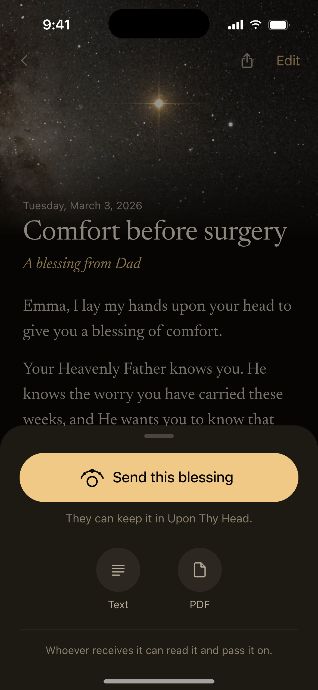

# Sharing a blessing: design notes

This folder answers the owner's three points: use icons more than words, steer people to the blessing file rather than plain text, and decide what happens when the person receiving it doesn't have the app.

- `index.html` is the clickable mock. Use the controls beside the phone to switch layout S1/S2/S3, way V1/V2, who receives it, English/Spanish, larger text and Reduce Motion. The list of steps is clickable too. Extra screens (offline, Your links, stop a link, link stopped) are under the step list.
- `shots/` holds 3x screenshots, numbered in flow order. Files starting `es-` are Spanish and files starting `big-` are larger text.
- `compare.png` shows the three sheets side by side, with the V1 and V2 receiver screens in rows beneath.
- To rebuild: `cd src && node build.mjs && node shoot.mjs`. This needs Node and system Chrome. Playwright is loaded from the npx cache.

Nothing outside `design/share/` was changed.

---

## 1. Recommendation: S1, "One main action"

S1 has one large gold button, **Send this blessing**, with the blessing icon. Under it, one line says why it's the better choice: *They can keep it in Upon Thy Head.* Text and PDF follow as two small round icons with one-word labels. At the foot is one plain line on who can read it.

Why S1:
- **It steers without scolding.** The owner expects people to reach for text. S1 makes the blessing the obvious tap and says what the receiver gains, without warning against text. Text and PDF stay one tap away, so nobody feels trapped.
- **The icons do the work, with a label as backup.** Each choice is an icon with one word under it: Blessing, Text, PDF. Labels stay because a light on an arc isn't yet a symbol anyone knows. Losing a share to a guess costs more than one word does.
- **It survives Spanish and large text.** It has a single column with no side-by-side labels that can collide. At the largest size in Spanish (`shots/big-es-01…`), the button wraps cleanly.

The alternatives:
- **S2, three in a row** (`02`). It is the most icon-led, but the three round buttons look like equals, even with the first one larger and gold. People will tap Text as often as Blessing. Use S2 only if "icons over text" matters more than "encourage the file".
- **S3, the blessing handed over** (`03`). This is my own design. A card shows the blessing itself (light, title, "A blessing from Dad"), so the gold button plainly sends *this*. Text and PDF are small chips under "Only the words". It feels the most like handing something over, but it's taller and has more words. Pick it if S1 feels too bare.

Icons: there are three new glyphs on the app's 24-unit grid, with a 1.5 stroke and round caps, matching `app/lib/widgets/icons.dart`. Small lights are filled dots, as in the app's sky glyph.
- **Blessing:** a sphere under an arch of hands, with three lights in the gaps.
- **Text:** lines of writing.
- **PDF:** a folded page.

There's also a **file** glyph (a page with the blessing's arch), used on "Send as a file". The app has no emoji and no coloured tiles.

---

## 2. V1 against V2

### V1: the file only

The sheet sends a `.blessing` file plus one line of text: *Open with Upon Thy Head: uponthyhead.app*.

| Who receives it | What happens | Shots |
|---|---|---|
| Has the app | Taps the file. The app asks "Keep it with your blessings?". After Keep, the blessing is in their list. | 05–07 |
| iPhone, no app | Taps the file. Quick Look shows a blank document: "Document · 2 KB". It's a dead end. Their only way forward is the line we sent with the file, which goes to a page saying "Someone sent you a blessing. Get the app, then tap the file again." | 08–10 |
| Android or other | "No app can open this file". Then the same line and the same page. | 11–13 |

**What V1 gives:**
- No server, no account and nothing stored anywhere but the two phones.
- The promise "the words stay on your phone" stays true as written.
- Nothing is built beyond the file, the line and one static page.

**What V1 costs:**
- Someone without the app can't read the blessing at all until they install it. The blessing is held back exactly when it's needed most: the night before surgery, sent to a grandparent with an Android phone.
- After installing, they must go back to the message and tap the file again. Many won't.
- **Needs checking on a device:** even when the app is installed, Messages may open a `.blessing` file in Quick Look first, so the receiver has to tap Share › Upon Thy Head. If so, the "has the app" path is worse than drawn.

### V2: a locked link

The sheet makes a link like `uponthyhead.app/b/x7Kp2#…`.

How the link works:
1. The blessing is locked (encrypted) on the sender's phone.
2. Only the locked copy goes to our server.
3. The key is the part after `#`, which browsers never send to a server.
4. The copy is erased after 30 days, or sooner if the sender stops it.

| Who receives it | What happens | Shots |
|---|---|---|
| Has the app | The link opens the app straight to "Keep it with your blessings?" | 17–18 |
| iPhone, no app | A web page in the app's look shows the whole blessing, with "Keep it in Upon Thy Head" at the foot. | 19 |
| Android or computer | The same page. | 20–21 |
| After 30 days or a stop | "This link has stopped working." | 25 |

The sender sees:
- **Link made** (15). It explains the link: *Anyone with this link can read it. It stops working in 30 days. It is locked on this phone before it leaves. The server keeps the locked copy, never the key.*
- **Your links** in Settings (23). Each link shows its date and a Stop button, with a confirm step (24).
- **Offline** (22). A link can't be made without internet, so the sheet offers the file instead.

**What V2 gives:**
- Everyone can read the blessing at once, on any device, with no install. This is what the owner hoped the link would do.
- The app is offered while they're reading it, which is when they're most willing to install.
- The sender can stop a link.

**What V2 costs:**
- We'd run a server, which is a lasting cost with work on call when it breaks.
- Words leave the phone, though locked.
- Anyone the link is forwarded to can read the blessing. This is not end-to-end encryption.
- Our honest weak spot: the web page that unlocks the blessing is served by us. If our server were taken over, it could serve a page that reads the key. "Never the key" is true of the server's storage, not a guarantee against us being hacked.
- The promise in the app has to change. Today it says the words stay on your phone. Under V2 it would have to say something like:

  > The words are written on this phone. Nothing leaves it unless you share it. A shared link keeps a locked copy on our server for 30 days. The server never has the key, so it can't read it.
  >
  > Las palabras se escriben en este teléfono. Nada sale de él a menos que lo compartas. Un enlace compartido guarda una copia cerrada en nuestro servidor durante 30 días. El servidor nunca tiene la llave, así que no puede leerla.

**About the App Clip:**
- A link can open an App Clip, which could show the blessing and later hand it to the full app.
- It still needs the same server, because the clip is fetched by the link.
- Apple doesn't document whether a clip receives the `#` part.
- App Clip Codes can't carry links this long.

My read: build the web page first. Add a clip later if the page shows people want one, and test the fragment on a device before promising it.

**Both ways share these limits:**
- The 30-day life is my choice. The owner should set it.
- The iOS and Android screens (share sheet, Messages, Quick Look, Chrome) are drawn from memory, not captured.
- The link preview in Messages shows only "A blessing · uponthyhead.app". The server never knows the title, so it can't put the title in the preview. That's on purpose.
- If the sender cancels the system sheet, the unsent link should be erased right away.

---

## 3. What would be built

**V1:**
1. The sheet (S1) in the app: the blessing icon, the line sent with the file, and the two small actions.
2. The `.blessing` type registered on iOS (UTI, "open in place") and Android (intent filter for the file and its MIME type).
3. A static page at `uponthyhead.app` with an App Store / Play link.
4. A check on a device of what Messages does with a `.blessing` file, both with the app installed and without it.

**V2 adds:**
1. A small server, for example a Cloudflare Worker with R2 or KV, which:
   - stores locked copies (`PUT /b`, which returns a short id),
   - serves them (`GET /b/:id`),
   - erases them on expiry or on `DELETE`, using a delete token known only to the sender's phone,
   - limits upload rate and size,
   - keeps no logs of content.
2. The reader page at `/b/:id`. It unlocks the blessing in the browser (ChaCha20-Poly1305, matching the file format), draws it in the app's look, and offers Keep or the App Store.
3. Universal links / associated domains (iOS) and App Links (Android) for `/b/*`, so the app opens straight to Keep.
4. Making a link in the app: encrypt, upload, build the link, show Link made, and fall back to the file when offline. It also erases the link if the system sheet is cancelled.
5. **Your links** in Settings: a list kept on the phone with dates and Stop.
6. The privacy promise reworded (above), and the App Store privacy label updated.
7. Optional, later: an App Clip.

---

## 4. Every word, English and Spanish

### The share sheet (S1, S2, S3)
| | English | Español |
|---|---|---|
| Sheet title (screen readers) | Share this blessing | Compartir esta bendición |
| Main button | Send this blessing | Enviar esta bendición |
| Under it | They can keep it in Upon Thy Head. | Podrán guardarla en Upon Thy Head. |
| Icon labels | Blessing · Text · PDF | Bendición · Texto · PDF |
| S3 label | Only the words | Solo las palabras |
| Foot, V1 | Whoever receives it can read it and pass it on. | Quien la reciba puede leerla y reenviarla. |
| Foot, V2 | This sends a link. Anyone who has it can read the blessing. | Esto envía un enlace. Quien lo tenga puede leer la bendición. |

### V1: the file
| | English | Español |
|---|---|---|
| Line sent with the file | Open with Upon Thy Head: uponthyhead.app | Ábrela con Upon Thy Head: uponthyhead.app |
| File name | Comfort before surgery, March 3, 2026.blessing | Comfort before surgery, 3 de marzo de 2026.blessing |
| System sheet subtitle | Blessing file and one line of text | Archivo de bendición y una línea de texto |
| Receive | Keep it with your blessings? · Not now · Keep | ¿Guardarla con tus bendiciones? · Ahora no · Guardar |
| Page heading | Someone sent you a blessing. | Alguien te envió una bendición. |
| Page line | Get the app, then tap the file again. | Descarga la app y vuelve a tocar el archivo. |
| Page button | Get Upon Thy Head | Descargar Upon Thy Head |
| Page small line | Free. No account. No ads. | Gratis. Sin cuenta. Sin anuncios. |

### V2: the link
| | English | Español |
|---|---|---|
| Heading | Link made | Enlace creado |
| Line 1 | Anyone with this link can read it. It stops working in 30 days. | Quien tenga este enlace puede leerla. Deja de funcionar en 30 días. |
| Line 2 | It is locked on this phone before it leaves. The server keeps the locked copy, never the key. | Se cierra en este teléfono antes de salir. El servidor guarda la copia cerrada, nunca la llave. |
| Buttons | Send the link · Copy link · Your links | Enviar el enlace · Copiar enlace · Tus enlaces |
| Offline | No internet, so a link cannot be made now. | Sin internet no se puede crear un enlace ahora. |
| Offline button | Send as a file | Enviar como archivo |
| Offline note | It opens only in Upon Thy Head. | Solo se abre en Upon Thy Head. |
| Preview card | A blessing · uponthyhead.app | Una bendición · uponthyhead.app |
| Page, above title | Shared with you · until December 16 | Compartida contigo · hasta el 16 de diciembre |
| Page button | Keep it in Upon Thy Head | Guardarla en Upon Thy Head |
| Page small line | Get the app, then open this link again. | Descarga la app y vuelve a abrir este enlace. |
| Stopped heading | This link has stopped working. | Este enlace dejó de funcionar. |
| Stopped line | Links last 30 days, or less if the sender stops one. Ask them to send it again. | Los enlaces duran 30 días, o menos si quien lo envió lo detiene. Pídele que lo vuelva a enviar. |

### V2: Your links (Settings)
| | English | Español |
|---|---|---|
| Title | Your links | Tus enlaces |
| Intro | Each link stops working on its date. You can stop one sooner. | Cada enlace deja de funcionar en su fecha. Puedes detenerlo antes. |
| Row, live | Sent today · stops December 16 | Enviado hoy · hasta el 16 de diciembre |
| Row, older | Sent November 2 · stops December 2 | Enviado el 2 de noviembre · hasta el 2 de diciembre |
| Row, stopped | Stopped November 9 | Detenido el 9 de noviembre |
| Row button | Stop | Detener |
| Confirm | Stop this link? | ¿Detener este enlace? |
| Confirm line | It will no longer open, and the locked copy is erased. Anyone who kept the blessing still has it. | Ya no se abrirá y se borra la copia cerrada. Quien ya guardó la bendición la conserva. |
| Confirm buttons | Cancel · Stop link | Cancelar · Detener |

### Stand-in system words (not ours; shown so the screens read true)
| | English | Español |
|---|---|---|
| Quick Look | Document · 2 KB · Done | Documento · 2 KB · OK |
| Android | No app can open this file | Ninguna app puede abrir este archivo |

Wording rules followed:
- No exclamation marks.
- "Locked" is always paired with what it means: the server has the copy, never the key.
- "Private" and "secure" appear nowhere.
- Spanish lines were checked at large text. They wrap, and nothing gets cut off.

---

## 5. Questions for the owner, most important first

1. **V1 or V2?** Is it acceptable for a locked copy of a blessing to sit on our server for up to 30 days, so that people without the app can read it at once? If yes, the in-app promise changes to the wording in section 2. If no, the person without the app can't read the blessing until they install it.
2. **Is "anyone with the link can read it" acceptable?** The link can be forwarded, as a file can. A password or a "one device only" rule would make it stricter, but it would add steps for a grieving or anxious receiver.
3. **How long should a link last?** 30 days, 7 days, or until the sender stops it?
4. **Under V2, should the file still be offered every time,** or only when offline (as drawn)? Showing both means more choices; showing only the link means everyone depends on the server.
5. **S1, or S3 if S1 feels too bare?** S2 only if icons matter more than steering people to the file.
6. **Should the App Clip come now or later?** I'd ship the web page first and test on a device whether a clip receives the `#` key before planning one.
7. **Who owns the server?** It means a domain, a Worker and someone who answers when it breaks.
